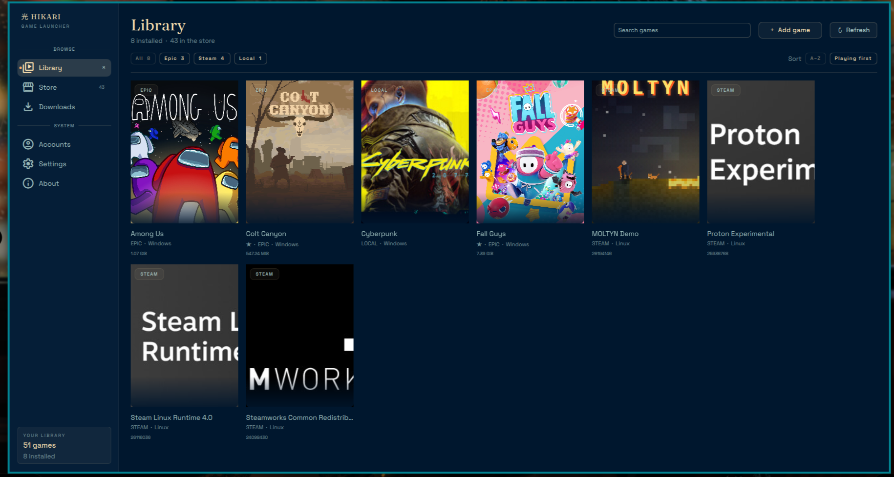
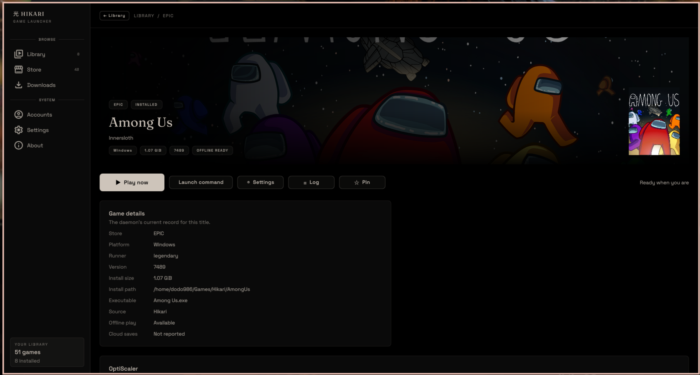

# Hikari

A native game launcher built with [Ryoku](https://ryoku.dev) in mind, but not
limited to it. One Go daemon owns the library, the store engines and the launch
pipeline; the Quickshell UI is its face. No webview, **no Electron**.

## Screenshots

<p align="center">
  
  
</p>

## What it does

- Follows Ryoku's palette, so the launcher stays in sync with the desktop.
- Drives the same engines Heroic uses — legendary (Epic), gogdl (GOG), nile
  (Amazon) — with isolated credentials, so Heroic and Hikari can coexist.
- Imports games Heroic already installed, read-only: Heroic's config tree is
  never written.
- Reads Steam libraries (native, Flatpak, Snap), read-only; Steam games
  launch only through Steam.
- Launches Windows games through umu/Proton or Wine, with a per-game prefix
  and the launch extras: DXVK/VKD3D/NVAPI, EAC/BattlEye runtimes, the EOS
  overlay, MangoHud, GameMode, gamescope and custom wrappers.
- Installs, updates, repairs and uninstalls through the stores' own engines.
- Cleans up OptiScaler (upscaling/frame generation) with GPU detection,
  verified downloads, backup of replaced DLLs and INI profiles.
- Adds your own games (local executables) with cover search and a native
  file picker.
- Mods games through the Amethyst Mod Manager's own backend: pick a profile
  and deploy it, restore the game to vanilla, install mod archives (FOMOD
  installers included) or `nxm://` downloads. Amethyst owns the mod state and
  Hikari never keeps a second copy of it.
- Stores the library and pins locally; a UI store view shows what you own
  but have not installed.
- Keeps diagnostics the user can reach: a rotating daemon log, per-game last
  launch output, `hikari logs`, `hikari report`, and a Diagnostics panel in
  Settings.

## Requirements

- Linux; the UI needs [Quickshell](https://quickshell.org) and the Ryoku.Ui
  QML module (a Ryoku desktop provides both).
- Go 1.27 to build from source.
- Store engines on `PATH`: `legendary`, `gogdl`, `nile` (optional: `comet`
  for GOG achievements).
- `umu-launcher` and/or Wine/Proton builds for Windows titles.
- For the Mods page: `python3` and an Amethyst Mod Manager install
  (`hikari mods setup` fetches the backend's Python packages into Hikari's
  own data directory; Amethyst itself is not bundled).
- `7z`/`7zz` for release archives (Proton, OptiScaler).

## Install

Download `hikari-vX.Y.Z-x86_64.AppImage` from
[Releases](https://github.com/dodo986/hikari/releases), make it executable and
run it:

```sh
chmod +x hikari-vX.Y.Z-x86_64.AppImage
./hikari-vX.Y.Z-x86_64.AppImage
```

The AppImage carries the daemon, the CLI and the UI; Quickshell and the
Ryoku.Ui module still come from the system (Ryoku ships both), and it must
stay in a writable folder so it can update itself.

Or install the tarball into your home:

```sh
mkdir -p hikari && tar -xzf hikari-vX.Y.Z-x86_64.tar.gz -C hikari
./hikari/install.sh
```

Or build from a checkout:

```sh
scripts/install-user.sh
```

This builds `hikarid`, `hikari` and the app launcher into `~/.local/bin`,
deploys the UI, installs the icon and adds **Hikari to your app launcher**.
Launch it from the menu (or run `hikari-app`): it starts the daemon if needed
and opens the window; launching it again focuses nothing new, it reuses the
running instance.

A packaged install lives in `packaging/` (PKGBUILD, desktop entry, systemd
user unit).

## Use

```sh
hikari status
hikari list --installed
hikari refresh
hikari launch epic <id> --dry-run     # the exact command it would run
hikari launch epic <id>
hikari install epic <id> --path ~/Games/Hikari --follow
hikari update epic <id> --follow
hikari options epic <id>              # engine launch options
hikari wines                          # discovered Wine/Proton builds
hikari wine install GE-Proton11-11 --follow
hikari settings epic <id> --set '{"show_mangohud": true}'
hikari auth login epic                # prints the login URL, takes the code
hikari logs --lines 80                # daemon log (works with it stopped)
hikari logs --game epic <id>          # last launch output
hikari report                         # paste-ready diagnostics bundle
```

Every command accepts `--json`. `hikari --help` lists the rest
(`favorite`, `add-local`, `remove-local`, `repair`, `saves`, `stop`, ...).

## Updates

Hikari checks GitHub for newer releases. When one exists, an **Update
available: vX.Y.Z** button appears in the sidebar above the library card. It
downloads the release tarball, verifies its sha256, replaces the binaries and
the UI, restarts the daemon and reopens the window; if the new daemon fails
to start, the previous install is restored.

An AppImage updates the same way: it downloads the new AppImage next to the
current one, verifies the checksum, swaps the file and reopens the window.

```sh
hikari update-check        # current vs. latest release
hikari update-apply        # the same update from the terminal
```

Releases are built with `scripts/release.sh 0.1.1` for the tarball and
`scripts/build-appimage.sh 0.1.1` for the AppImage; both assets and their
`.sha256` files go on the GitHub release. The default repository is
`dodo986/hikari`; set
`HIKARI_UPDATE_REPO=owner/repo` for a fork. Installs that live in a
read-only prefix (`/usr`) refuse in-place updates and point at the package
manager.

## Where things live

| Path | Contents |
| --- | --- |
| `~/.config/hikari/settings.toml` | global settings (engines, defaults, artwork key) |
| `~/.local/share/hikari/` | library state, local games, engine configs, downloaded tools, `hikarid.log` |
| `~/.cache/hikari/` | artwork cache |
| `$XDG_RUNTIME_DIR/hikari.sock` | JSON-RPC endpoint (owner-only) |

The daemon is the only writer; the CLI and UI are clients.

## Build and test

```sh
go build ./...
GOPROXY=off go test ./...     # offline; the module is vendored
go vet ./...
scripts/test-ui.sh            # offscreen QML hit-tests for the popout
scripts/dev.sh                # demo daemon + UI, nothing real touched
```

## License

GPL-3.0-or-later. See `LICENSE`; `NOTICE` credits the projects whose
behaviour Hikari mirrors (Heroic Games Launcher, Ryoku, OptiScaler).

**LLM(s) were used for optimization, bug fixes, code cleanup, distribution etc.**
